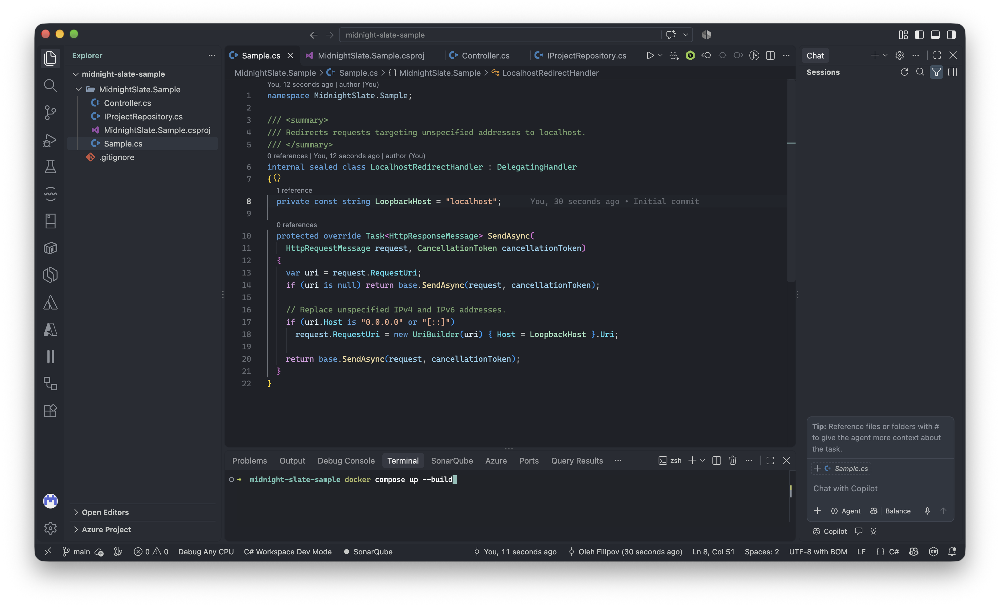
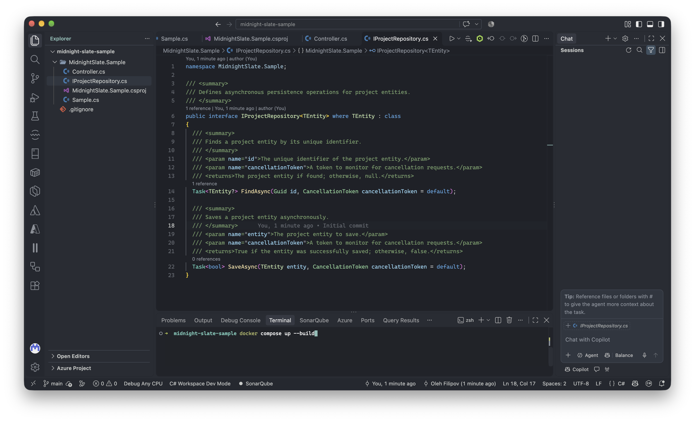
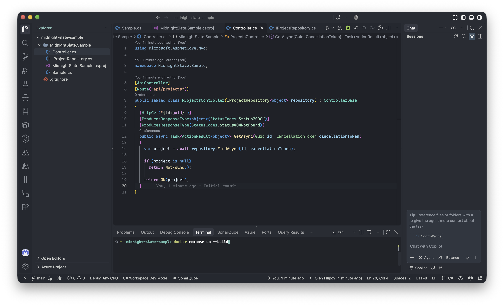
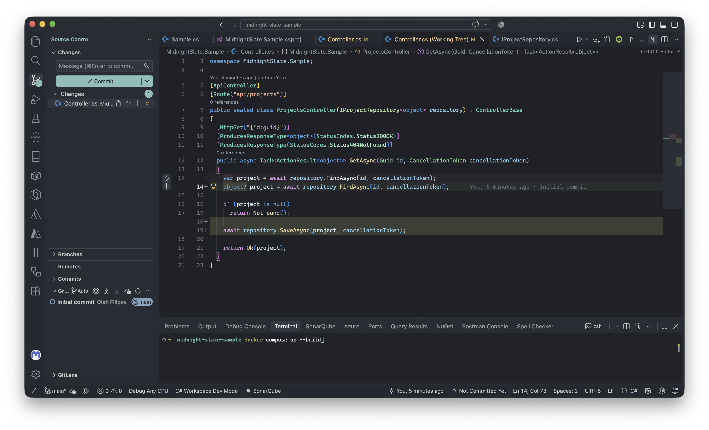
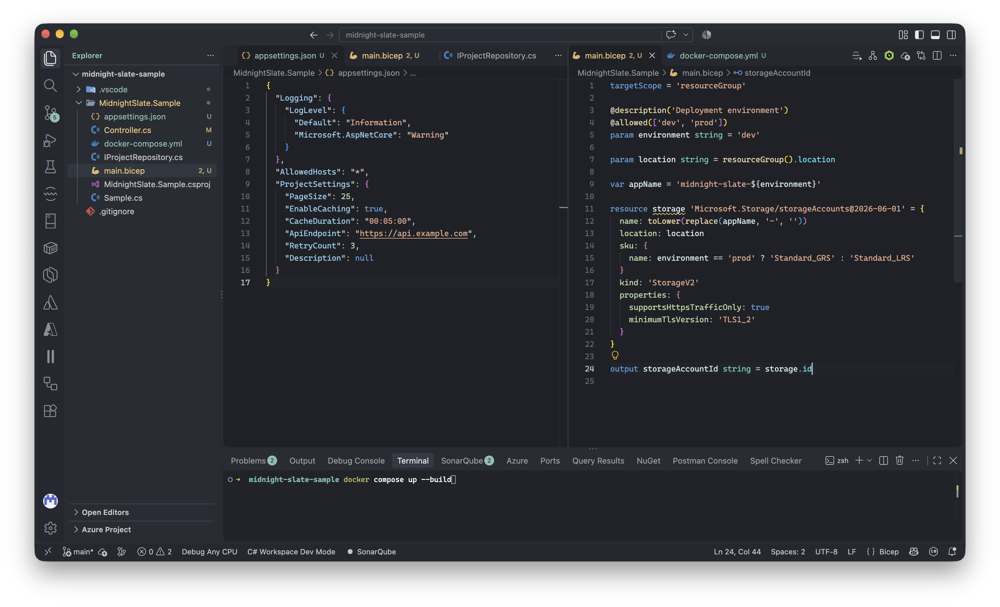

# Midnight Slate

A dark theme for Visual Studio Code, primarily designed for C# and .NET development.

Midnight Slate combines a charcoal interface with muted accents and distinct syntax colors. It includes editor, terminal, Source Control, and workbench colors, with additional attention to JSON, YAML, Bicep, Razor, and other languages commonly used in .NET development. Other languages use the same color palette, but have not been tested extensively.

## Preview

### C# and .NET







### Source Control



### JSON and Bicep



## Installation

Install **Midnight Slate** from the Visual Studio Code Marketplace.

Open **Preferences: Color Theme** in Visual Studio Code and select **Midnight Slate**.

No additional extensions, fonts, or configuration are required to use the theme.

## Recommended setup

The screenshots show Midnight Slate alongside a few complementary extensions and editor preferences. None of them are required, but they help reproduce the overall appearance.

> **Configuring VS Code**
>
> To apply the settings below, open the Command Palette (`Cmd+Shift+P` on macOS, `Ctrl+Shift+P` on Windows/Linux), select **Preferences: Open User Settings (JSON)**, and add the settings you want.
>
> These settings apply to your editor globally. To limit them to a single project, add them to `.vscode/settings.json` in that project instead.

### Icons

The screenshots use [Material Icon Theme](https://marketplace.visualstudio.com/items?itemName=PKief.material-icon-theme) for file and folder icons.

Install the extension and select **Material Icon Theme** using **Preferences: File Icon Theme**.

For the same subdued appearance, add the following to your VS Code user settings:

```json
{
  "workbench.iconTheme": "material-icon-theme",
  "material-icon-theme.saturation": 0.8,
  "material-icon-theme.opacity": 0.9,
  "material-icon-theme.folders.color": "#81a2be"
}
```

These settings reduce icon saturation and opacity and give folders a softer blue tone that complements the Midnight Slate palette.

### Font

The screenshots use [Cascadia Mono](https://github.com/microsoft/cascadia-code) with a slightly lighter font weight than its default.

```json
{
  "editor.fontFamily": "'Cascadia Mono', Consolas, 'Courier New', monospace",
  "editor.fontSize": 13,
  "editor.fontVariations": "'wght' 370"
}
```

Cascadia Mono must be installed separately. Font weight variation depends on the installed font supporting the requested variable axis.

### Other editor settings

A few additional settings used in the screenshots:

```json
{
  "explorer.compactFolders": false,
  "editor.renderWhitespace": "none",
  "editor.tabSize": 2,
  "editor.minimap.enabled": false,
  "diffEditor.renderSideBySide": false,
  "diffEditor.ignoreTrimWhitespace": false,
  "terminal.integrated.minimumContrastRatio": 1
}
```

These are personal layout and presentation preferences rather than requirements of the theme.

### Terminal

Midnight Slate includes colors for the VS Code integrated terminal, so its palette works without additional shell configuration.

The terminal appearance in the screenshots also reflects the following shell setup:

- **Shell:** Zsh
- **Framework:** [Oh My Zsh](https://ohmyz.sh/)
- **Prompt theme:** `robbyrussell`
- **Plugins:** `git`, `zsh-syntax-highlighting`, and `zsh-autosuggestions`

With Oh My Zsh installed, the relevant `.zshrc` configuration is:

```sh
ZSH_THEME="robbyrussell"

plugins=(git zsh-syntax-highlighting zsh-autosuggestions)

source "$ZSH/oh-my-zsh.sh"
```

The community plugins can be installed using:

```sh
git clone https://github.com/zsh-users/zsh-syntax-highlighting.git \
  ~/.oh-my-zsh/custom/plugins/zsh-syntax-highlighting

git clone https://github.com/zsh-users/zsh-autosuggestions.git \
  ~/.oh-my-zsh/custom/plugins/zsh-autosuggestions
```

### Related extensions

These extensions complement Midnight Slate for C# and .NET development:

- [Material Icon Theme](https://marketplace.visualstudio.com/items?itemName=PKief.material-icon-theme) — file and folder icons.
- [C# Dev Kit](https://marketplace.visualstudio.com/items?itemName=ms-dotnettools.csdevkit) — C# and .NET development support.
- [Bicep](https://marketplace.visualstudio.com/items?itemName=ms-azuretools.vscode-bicep) — Azure infrastructure authoring.
- [YAML](https://marketplace.visualstudio.com/items?itemName=redhat.vscode-yaml) — YAML language support.
- [GitLens](https://marketplace.visualstudio.com/items?itemName=eamodio.gitlens) — enhanced Git history and annotations.

These extensions are optional and aren't dependencies of Midnight Slate.

## License

MIT